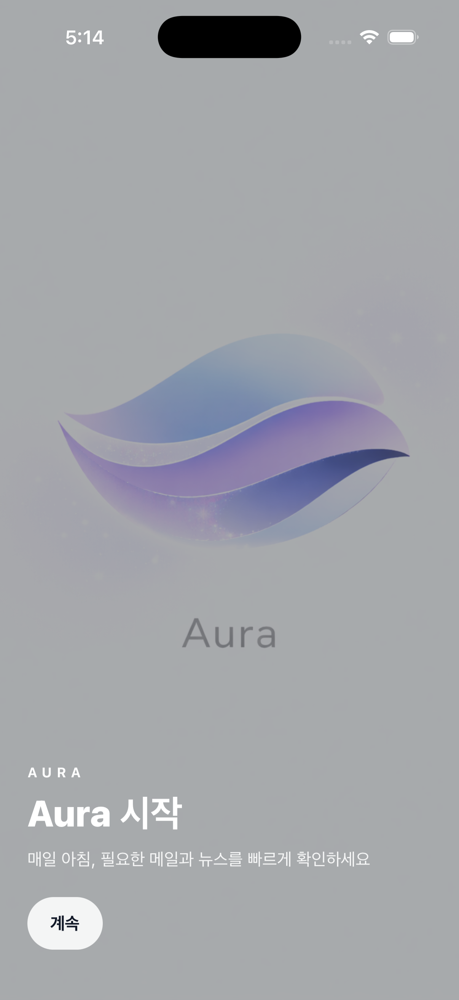

# Aura

  
  

_Ai assistant application for all users_

## Why?

친절한 AI 비서.

평소에 뭘 해야할지 캘린더에는 적어놓는데,

- 바로 몇 시에 그 작업이 있는지 확인하려면 캘린더에 들어가야함.
- 그리고 그 곳까지 가는데 길을 찾아야함.(대중교통 특히)
- 뉴스 읽기도 귀찮은데 세상은 알아야 할 것 같음(트럼프 형이 워낙워낙 빠꾸가 없으셔서 모르면 주식 꼬라박을수도)

내 성격이 이래서 내 문제를 해결하기 위해서 시작한 Application.

## Features(26/04/10)

1. 유저가 원하는 뉴스 토픽(최대 5가지)에 대한 요약을 받아볼 수 있음. 실제 뉴스 링크도 제공함.

   - briefing by anthropic api

2. 유저의 로그인한 구글 계정 기반으로 하루치 메일 분석 및 답변 초안 작성해줌

3. 유저의 휴대폰에 저장된 캘린더 + 구글 캘린더 내용을 가져와서 오늘, 내일 할 일 알려줌.

   - 다음 일정을 맞추기 위해 대중교통/자차로 언제 출발해야하는지 값 제공. + Google Maps 연동

4. Aura Chat. 솔직히 쓸모가 있다고 생각하지는 않아서 뭘 해야할지 모르겠음..

   - 진짜 뭘 해야할지 모르겠음 감이 안잡힘. 뭔가 신박한 아이디어가 아직 안나옴

## User Login

현재는 Google 계정으로 Login.

- Google Cloud Console (qww9363@gmail.com 으로 해놨음.)

메일 분석을 Gmail 토대로 분석하기 때문에 유지할듯.

### phone check

<https://console.solapi.com/dashboard>

- dumbteam2025@gmail.com 사용, 전화번호 인증하라해서 조민제 명의로 진행함

## Language

한국어 / English

- 설마 더 다른 언어가 필요할까. 필요하면 번역기 돌린다는 마인드

## Version

### Alpha Version

2026/04/10 update

by. codex cli (plus)

순수하게 내가 쓰려고 만들기 시작했는데 이왕 하는김에 할짓 없을때 하면 좋겠다라고 생각해서 만들기 시작한게 이렇게 됨

Design부터 어플 이름까지 죄다 AI한테 맡겨서 신박한 경험임(Aura 라는 어플 이름도 AI가 정해준 것으로 기억남. **A**i, for **U**ser **R**eliable **A**ssistant << 방금 이거 쓰면서 대충 정해봤음. 왜 처음에 Aura라고 했는지 모르겠네?)

- 나중에 저 이름 길게 한 버전을 어플에 깔끔하게 넣으면 좀 멋있을 듯.

---

**실제 테스트 영상**

  <video width="50%" controls>
   <source src="https://youtube.com/shorts/FxfYeaELkao?feature=share" type="video/mp4">
  </video>

[Youtube Link](https://youtube.com/shorts/FxfYeaELkao?feature=share)

- Ai Chat 기능에서 만들다가 뭘 할지 당장 생각이 안나서 일단 냅두고 있음. 생각나면 만든다는 마인드 ;;
- 그때 그때 생각나는 추가적인 것 있으면 수정할 예정.
